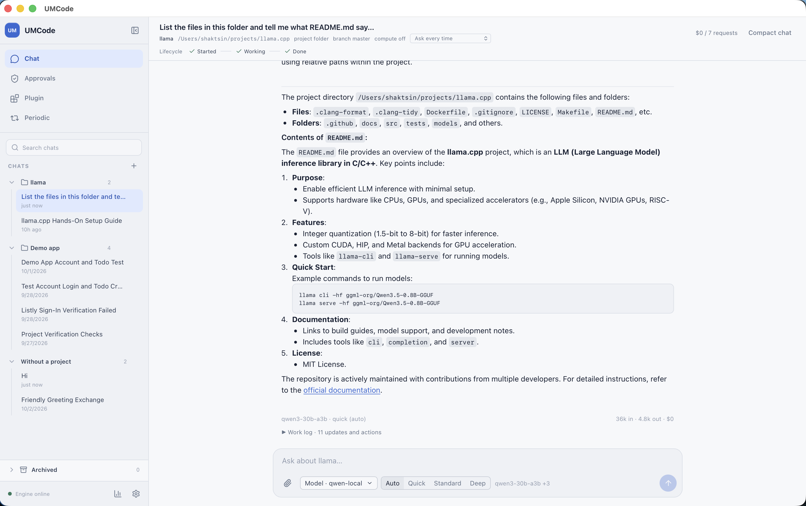
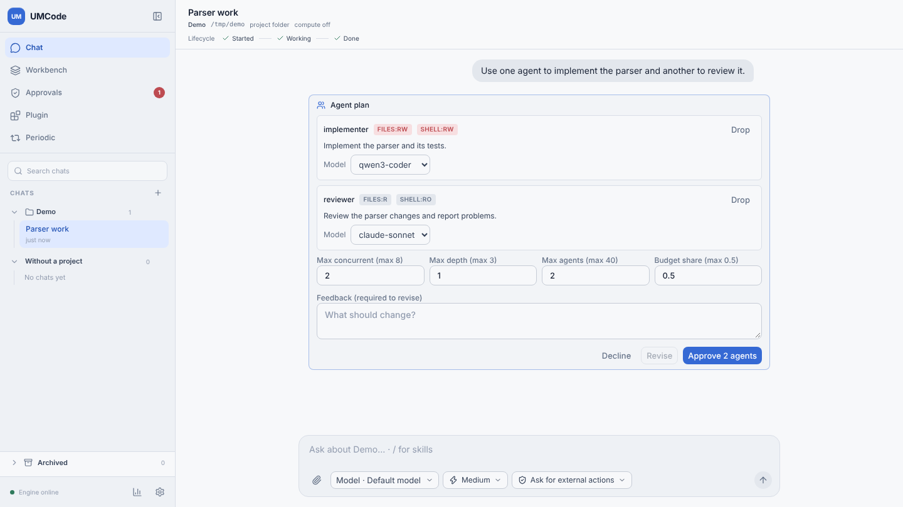
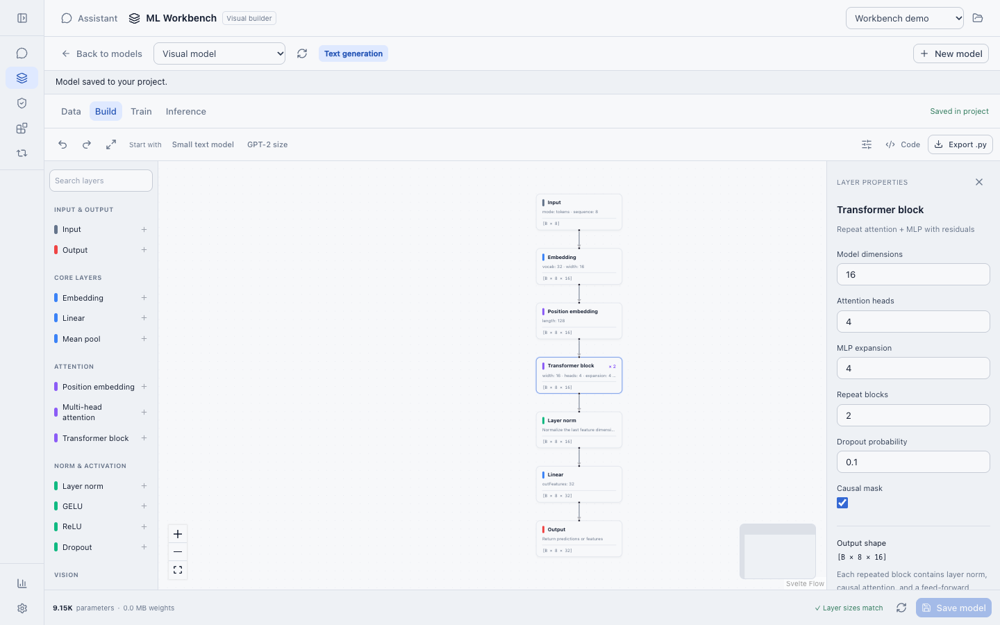
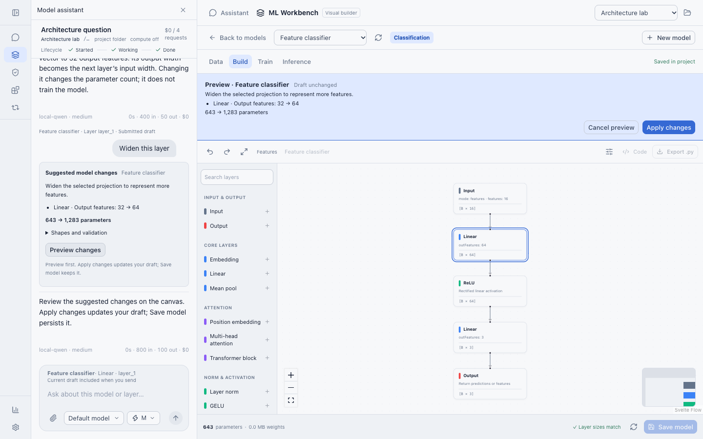
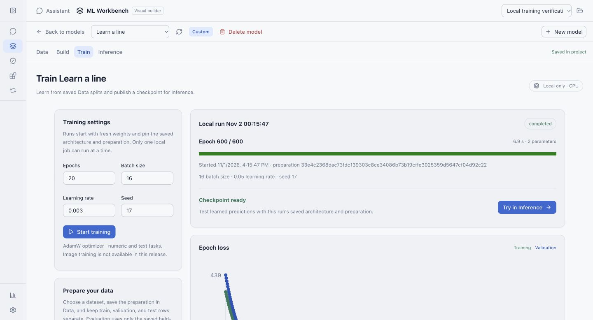

# UMCode

A Mac coding agent for the models you choose, hosted or local. When one hits a quota or rate limit, the next model in your pool continues. Free and open source (MIT). Site: [umcode.dev](https://umcode.dev).

Choose a project folder and UMCode keeps its chats and project instructions together. Start a clean chat or a contextual side chat, choose configured provider/model IDs, or combine models into an ordered pool. Tool actions stay visible, with approvals for sensitive operations. Chats and settings stay on your Mac; prompts go only to the models you configure.

**Download:** [UMCode.dmg](https://github.com/shaktsin/umcode/releases/latest/download/UMCode.dmg) (macOS 14+, signed and notarized), or [build from source](#build-and-run).



## What's new in 0.4.3

- **Agents.** Ask for several agents in one message. A plan card shows each agent's purpose, model, file/shell/network access and limits before anything runs. Agents work in isolated checkouts of a private snapshot of your project (Git is not required), the lead integrates and verifies the results, and a merge stops if you edited the target files in the meantime. Agents share one budget, and you can cancel or continue them from the Agents panel. See the [agent guide](docs/subagent-development.md).
- **Visual ML Workbench.** Build text, vision and feature-vector models as connected layers with live shapes and validation, export the generated `.py`, ask the assistant about a layer and preview its proposed change before applying it, bring data from local files or Hugging Face, train on CPU with train/validation/test metrics, try the checkpoint in Inference, and promote it to chat. You can also import and inspect GPT-2, Llama, Mistral, Qwen2, BERT, ViT, ResNet and ConvNeXT weights. See the [Workbench guide](docs/ml-workbench/README.md) and [imported models](docs/workbench-imported-models.md).
- **Automatic context compaction.** Older history is summarized before the window fills and full output stays saved. UMCode reads the loaded context from Ollama and assumes 256,000 tokens when it cannot tell. It never blocks a turn. See [model capacity and compaction](docs/model-capacity-and-compaction.md).
- **Effort control.** Low, medium or high effort from the message box, including thinking control for local llama.cpp models.
- **Smaller changes.** First-run provider tiles, effort and approval-mode pills on the composer, approvals docked above the message box, live activity and turn time, the `/` skill picker, and globally installed skills.

### Agents



The plan card is shown before agents start. The agents in this capture are example data.

### ML Workbench

Training runs on CPU and needs the PyTorch runtime installed separately. Image training is not included yet, and small models trained from scratch can produce gibberish: a finished run shows that training executed, not that answers are good.

| Build | Ask | Train |
| --- | --- | --- |
|  |  |  |

---

- **Project-aware chats** — work in a selected folder with its `UMCODE.md` instructions
- **Provider and model choice** — use configured models directly or create ordered pools across providers
- **Quota-aware routing** — move to the next model in a pool when a provider reports a retryable quota or rate-limit failure (see `config.example.yaml`)
- **Local controls** — keep chat history, model settings, engine status, and approval workflows in one desktop app
- **Protected credentials** — provider API keys are stored in the macOS Keychain
- **Unified plugins** — install portable Agent Plugins or compatible Codex and Claude plugin folders containing skills, MCP servers, hooks, and metadata

---

## Build and run

Requires Go 1.24+ and, for the desktop app, Node.js. See [GO_ENGINE.md](GO_ENGINE.md) for the full guide.

```bash
make go-build                 # build the engine + CLI → bin/umcode
./bin/umcode engine         # run the engine in the foreground
make app-build                # build UMCode.app (macOS)
make help                     # list all targets
```

## Plugins

Plugins are the only extension unit shown in the desktop app. Open **Plugins**, enter a local folder or Git URL, and choose **Inspect** before **Install**. Inspection shows the package identity, compatibility diagnostics, executable capabilities, requested settings, and whether additional trust is required. UMCode accepts the portable Agent Plugins `plugin.json` format, Codex `.codex-plugin/plugin.json` folders, and Claude `.claude-plugin/plugin.json` folders.

Managed installs copy verified bytes into `~/.umcode/plugins/cache/<source-id>/<plugin>/<version-or-digest>/`, so they keep working if the source disappears. Linked installs track a local source folder and add an explicit **Reload** workflow for development; each active generation still runs from an immutable cached snapshot, and source edits take effect on reload. Installations and skills are user-global; MCP integrations, hooks, and non-secret settings are per project. Secret settings live in the Keychain or protected secrets file, never SQLite. Mutable plugin data belongs under `~/.umcode/plugins/data/<source-id>/<plugin>/` and is retained on uninstall.

Runtime declarations reference configuration explicitly with `{{setting:name}}` and protected values with `{{secret:name}}`. Plugin MCP servers cannot forward arbitrary host environment variables, and sensitive HTTP headers must use a declared secret reference. Skill-script output and hook diagnostics redact resolved secret values. A plugin with required configuration installs disabled for the selected project; configure it, then enable it after its required components activate successfully.

Hooks run commands from the installed package with a minimal environment and bounded input/output. `TurnStart` and `BeforeToolUse` may block; no hook can bypass UMCode's built-in guards, policy decisions, or approval prompts. Each turn retains one immutable capability snapshot, so reloading or disabling a plugin affects new turns only.

```bash
umcode plugin inspect ./my-plugin
umcode plugin install ./my-plugin --project prj_…
umcode plugin install ./my-plugin --linked --project prj_…
umcode plugin list --project prj_…
umcode plugin enable SOURCE_ID/PLUGIN --project prj_…
umcode plugin reload SOURCE_ID/PLUGIN      # linked installs only
umcode plugin remove SOURCE_ID/PLUGIN --disable-projects
```

Legacy standalone `skill` commands, `skill_dirs`, and `mcp_servers` remain backend-compatible during the migration window, but they are not separate sections in the desktop Plugins screen.

In a main or side chat, type `/` at the start of a message to find available skills
by name or description. Use ↑/↓ and Enter or Tab, or click a skill, to insert its
command. Add your instructions before sending; selecting a skill does not send
the message. Escape closes the picker. Sending `/plugin:skill your request`
loads that exact installed skill's instructions in any chat, including chats without a project.
If multiple installed sources share a plugin name, their skill commands include
the source ID (for example, `/sourceid.plugin:skill`) to distinguish them.

### Token optimization

Open **Settings → Token optimization** to enable the complete optimization system globally: context compilation and retrieval, progressive tools, result reduction, internal workflow tracking and verified memory promotion. All components operate automatically across chats, without separate opt-ins or internal design/planning approval prompts. Chat action permissions still apply.

The saved switch survives restarts and applies to new turns; active turns keep their current settings. Fresh installations start with it off until rollout qualification. Existing YAML feature flags remain effective until you save an explicit global choice; the settings panel identifies legacy or mixed configuration. Saving on enables the whole bundle, and saving off overrides all legacy component flags. Turning it off retains history and stored memory but omits generated memory from subsequent optimized prompt retrieval and stops new promotion. User-written project instructions remain available. Projectless design chats use evidence-linked decisions and completed deliverable tasks; they do not report an execution test pass or human acceptance.

For isolated token optimization regression campaigns and explicit live qualification, see [Paired evaluation](docs/evaluation.md).

Open **Turn details** from a response menu to inspect the settings captured when a turn started, its recorded token and cost measurements, context sources, and tool diagnostics. Values the provider or engine did not measure are shown as unavailable; opening the inspector does not make another model call. Legacy turns may not have detailed measurements.

For project knowledge, open **Project settings → Memory** to review generated and corrected entries. Corrections become user-owned instructions. Retirement removes an unchanged generated bullet when ownership is clear; an edited or user-owned instruction stays in `UMCODE.md` and remains ordinary project guidance.

The **Vault storage** controls on **Settings → Token optimization** show indexed vault objects and bytes, set retention for raw, stale, large, and redacted unreferenced objects, and run **Clean up now**. Statistics count shared vault objects once and are not total application disk usage. Cleanup reports what it actually deleted and freed; active work evidence and evidence supporting live project memory remain protected. Project-wide purge and forced deletion of referenced evidence are not available. Live paid rollout qualification remains a separate opt-in evaluation.
