# Workflow snapshots

Captured from the real Svelte app and Go engine by
`app/frontend/e2e/visual-workbench.mjs`, using temporary test projects. The
validation messages, model names, generated code and parameter counts come from
the running application. No training results are simulated.

## Create a model

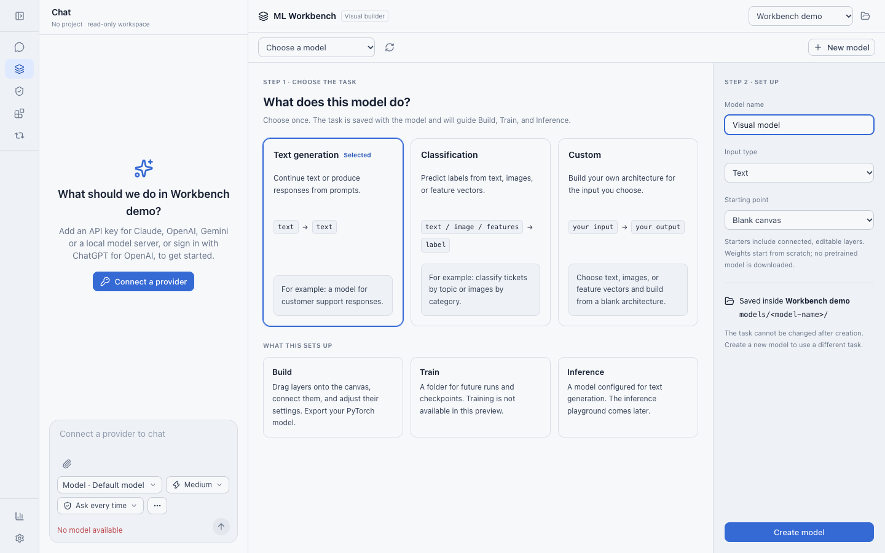

## Return to models with an unsaved draft

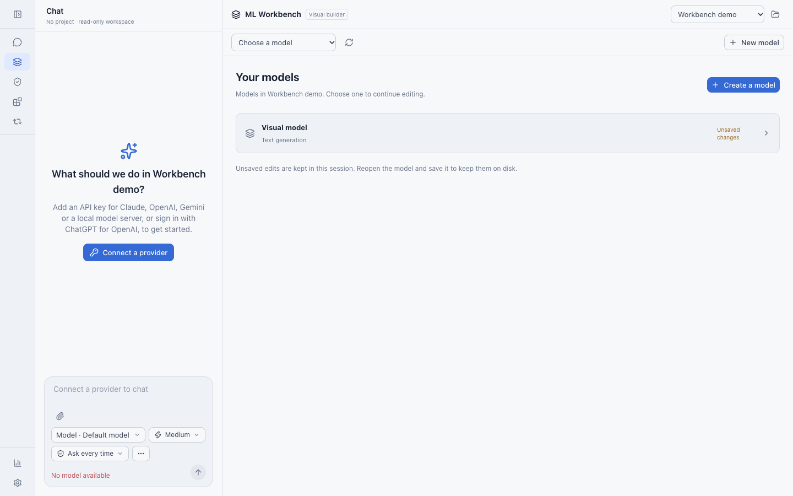

## Build a text model

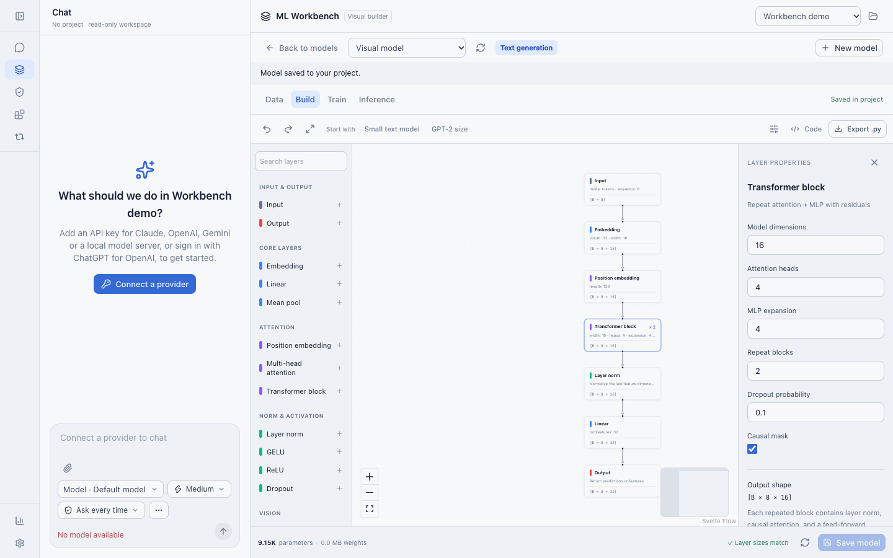

## Inspect and fix validation issues

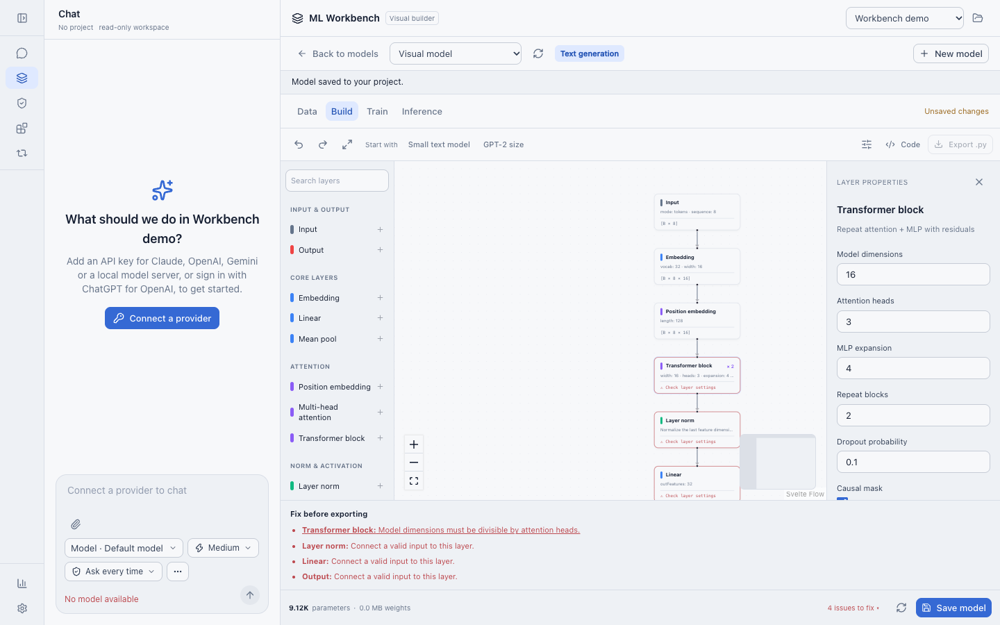

## Inspect generated code and export Python

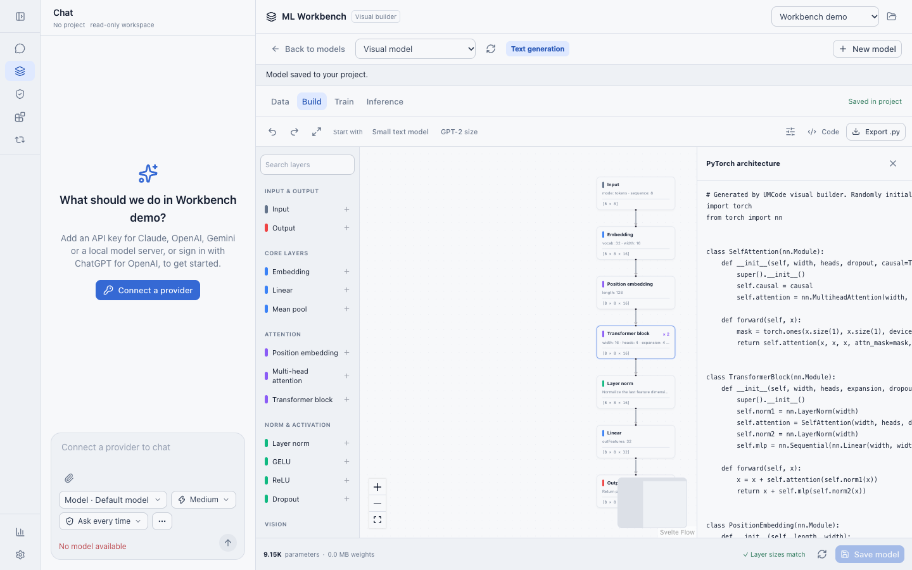

## Classify text

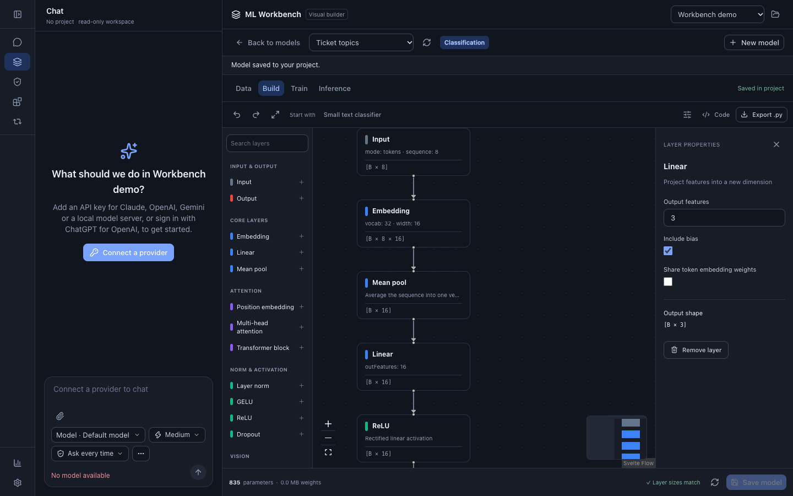

## Choose vision input and a CNN starter

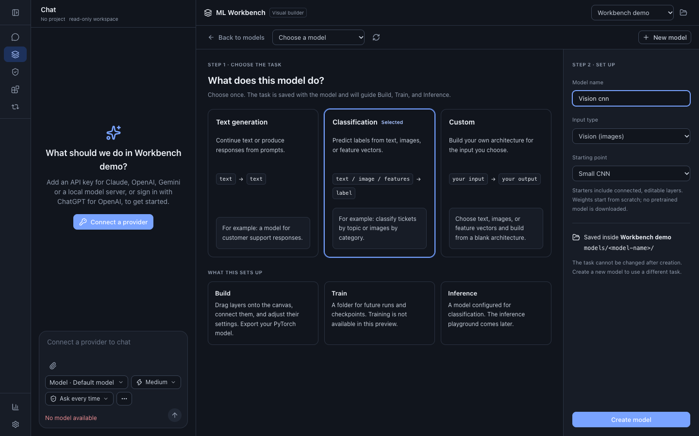

## Edit a CNN

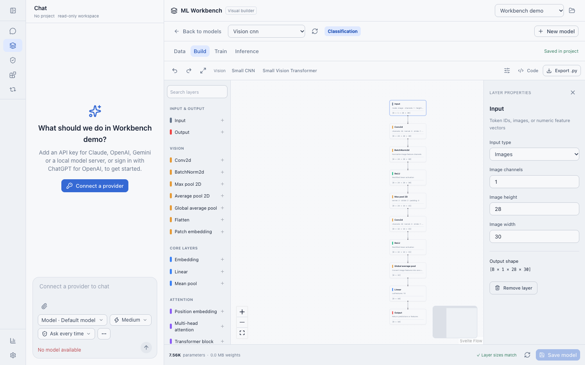

## Edit a vision Transformer

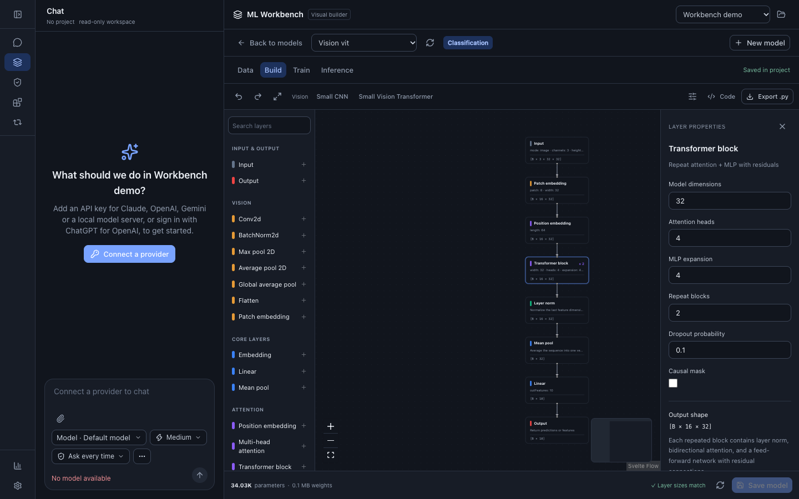

## Classify feature vectors

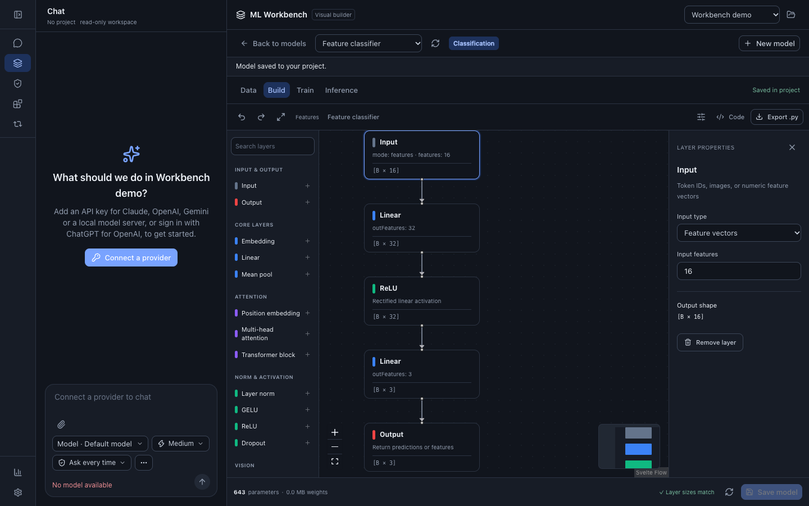

## Build a custom image architecture

This intentionally unfinished example shows a newly dragged Conv2d layer wired
to Image Input; the missing Output is reported explicitly.

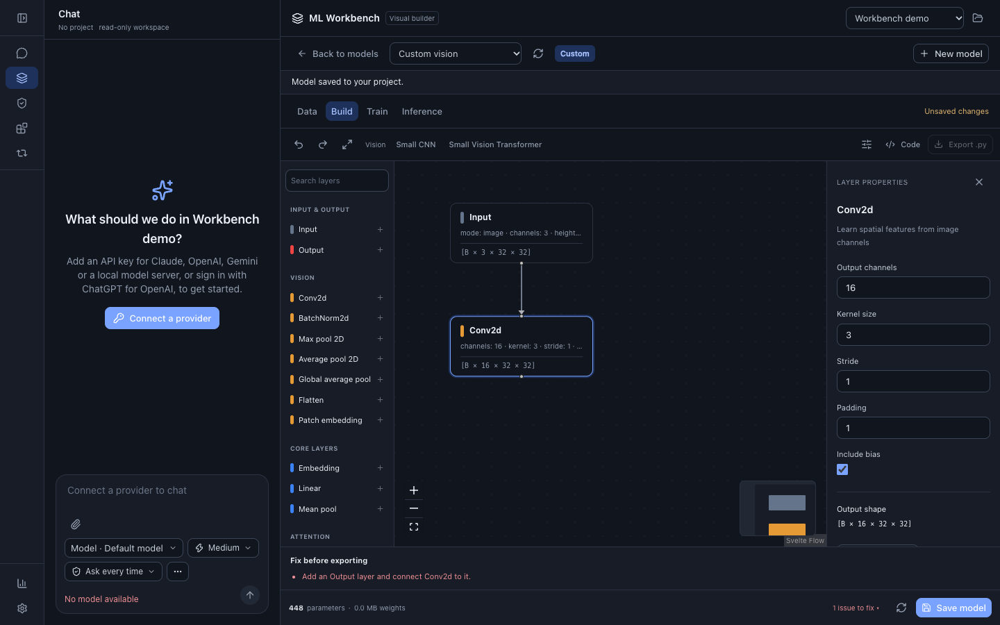

## Use a narrow dark layout

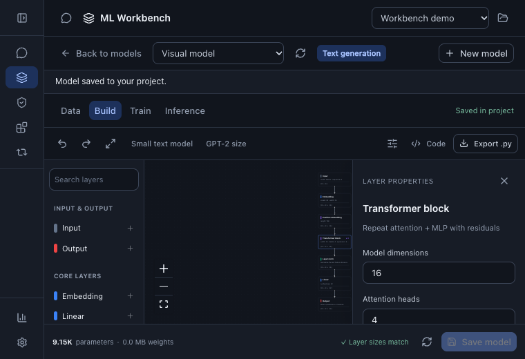

## See the current training boundary

Training is not implemented by this PR. Data and Inference have corresponding
unavailable states.

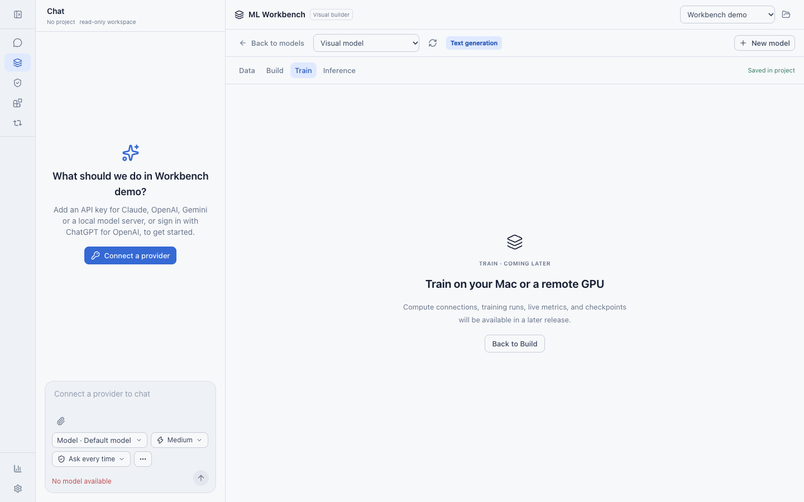
