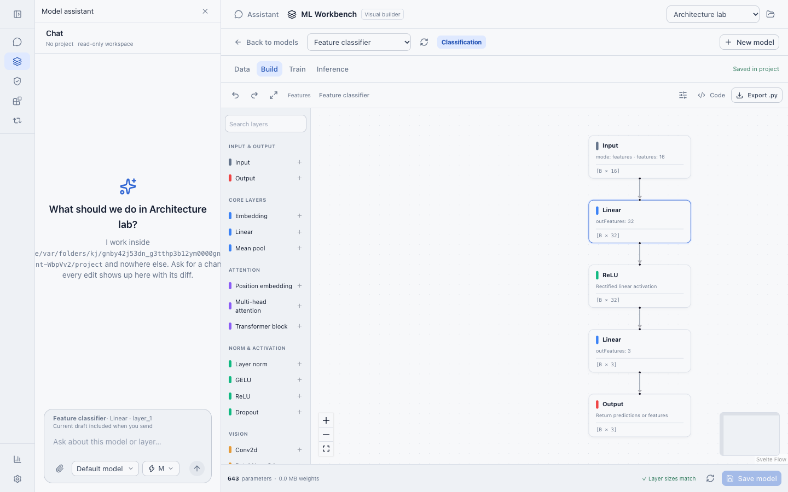
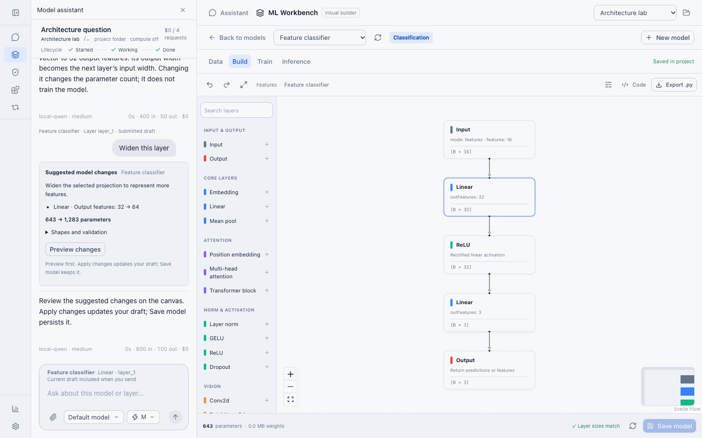
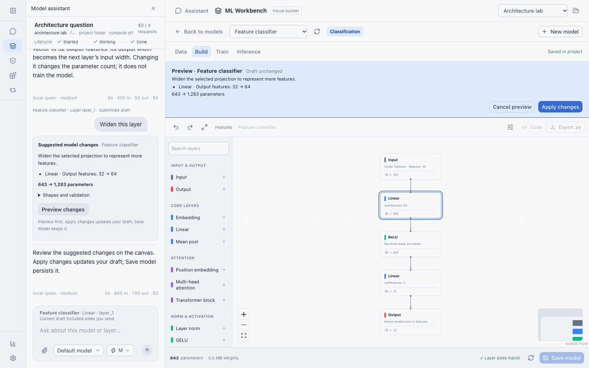
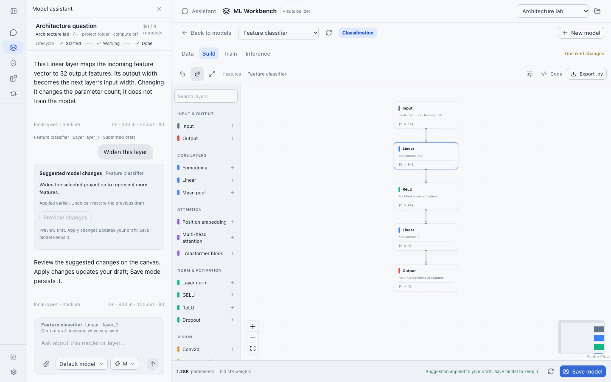
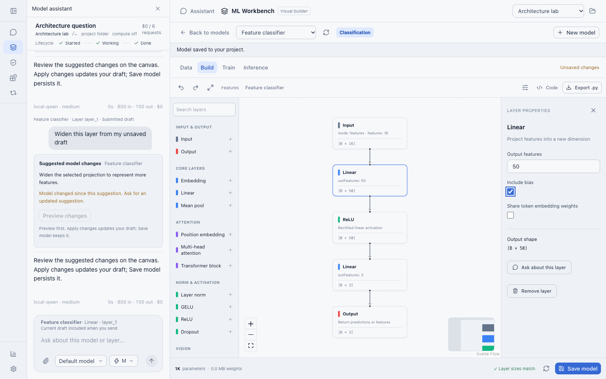
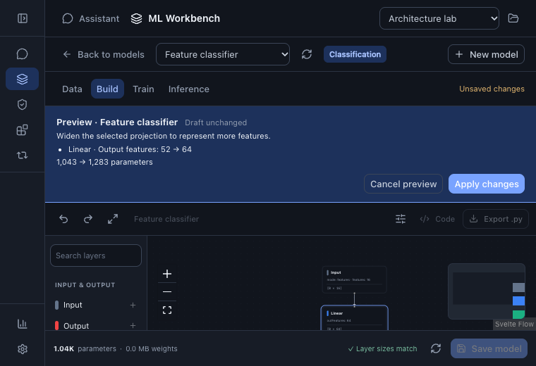

# Model assistant workflows

Captured from the actual app and engine using temporary projects and a local,
deterministic HTTP/SSE provider. These are UI acceptance captures; they do not
claim trained-model behavior or validate the quality of a live LLM's advice.

## Ask about the selected layer

## Inspect a proposed change

## Preview before applying

## Apply to the unsaved draft

## Preserve newer manual edits

## Preview in a narrow dark layout

