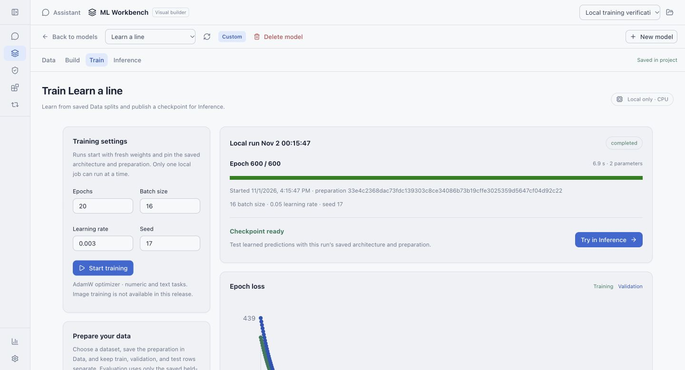
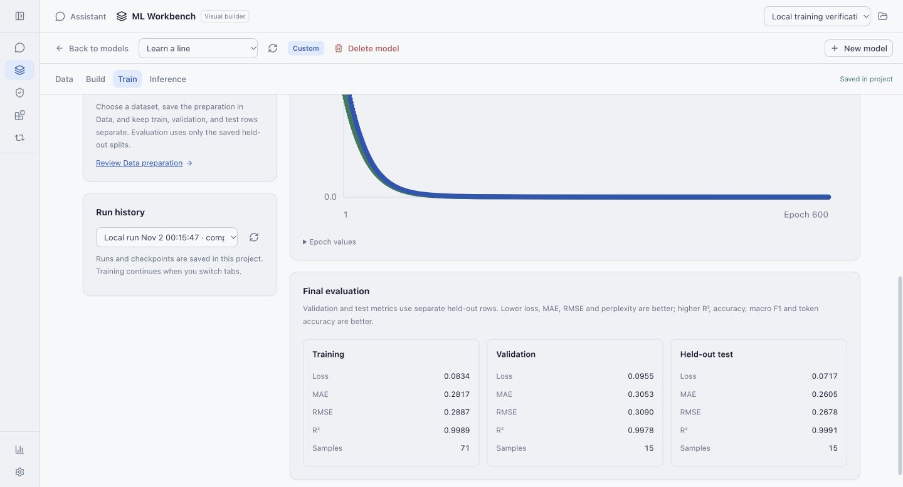
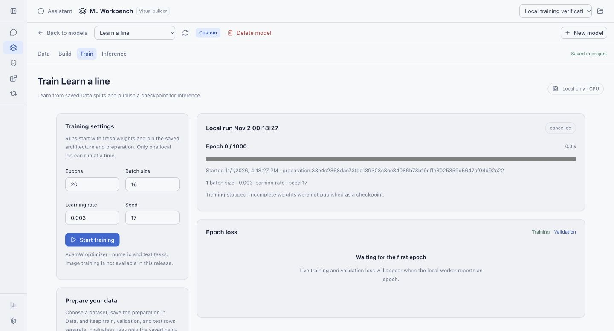

# Data, Train and Inference workflows

Captured from the real Svelte app and Go engine using an isolated project and an
empty in-memory secret store. Numeric/text examples are synthetic trained fixtures;
Hugging Face inspection/download uses the real public native-file endpoint.

## Local data import and preparation

## Hugging Face inspection

## Test an architecture without trained weights

## Test a trained prompt and promote its checkpoint

## Use the promoted checkpoint in regular chat

The final capture needs no cloud API key, exposes plain text chat controls, and uses
real generated text from the pinned checkpoint. These small trained examples establish execution, not general answer quality.

## Train locally and create a checkpoint

This capture uses an isolated synthetic numeric-regression project. The run writes its own checkpoint and exposes separate training/validation/test metrics. Training progress and Stop were exercised through the real browser. See the [Train guide](../../local-training.md) for metrics and model-quality limitations.

