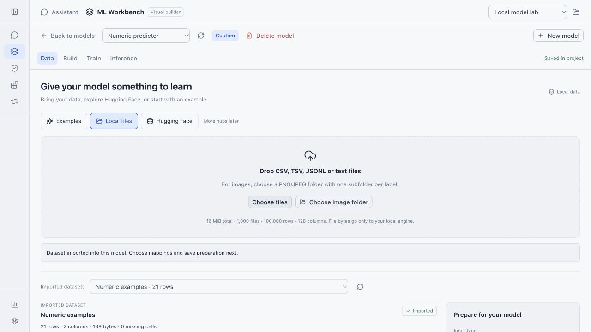
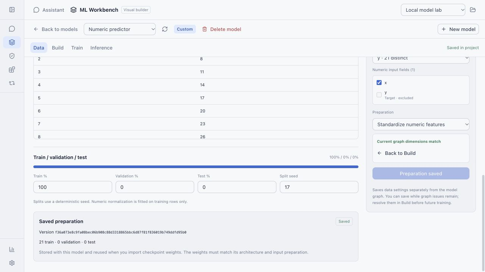
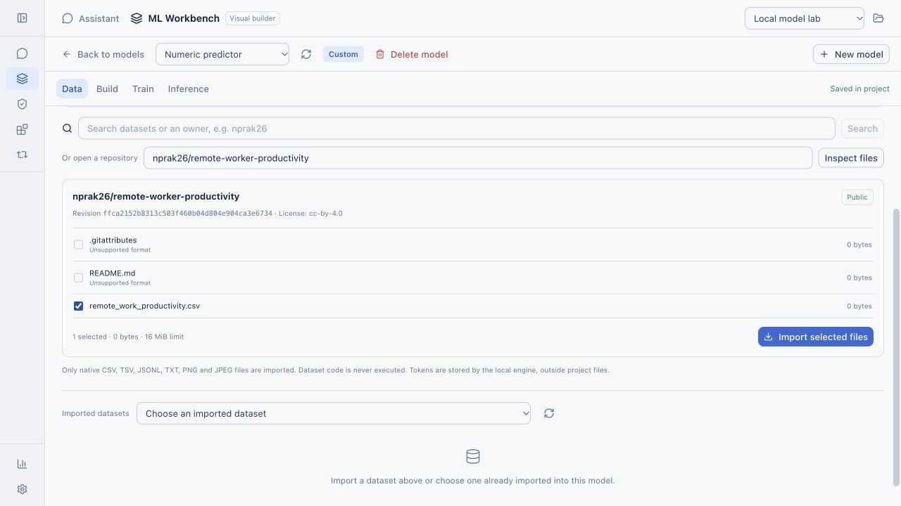
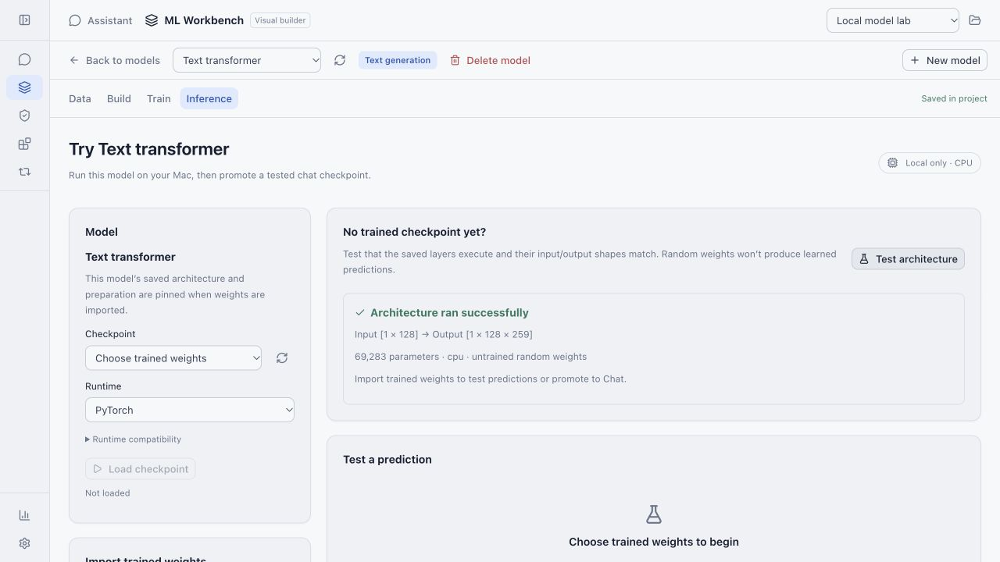
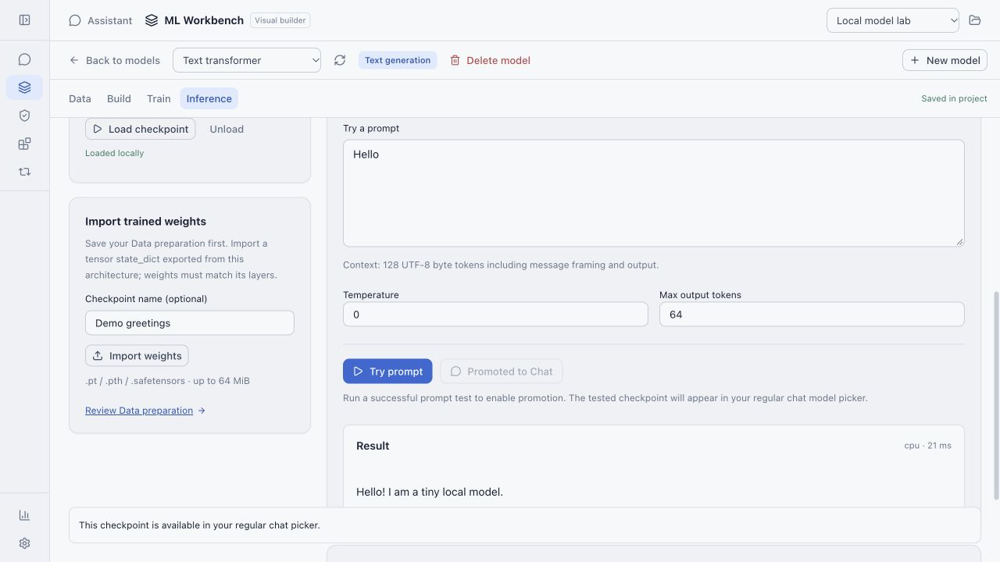
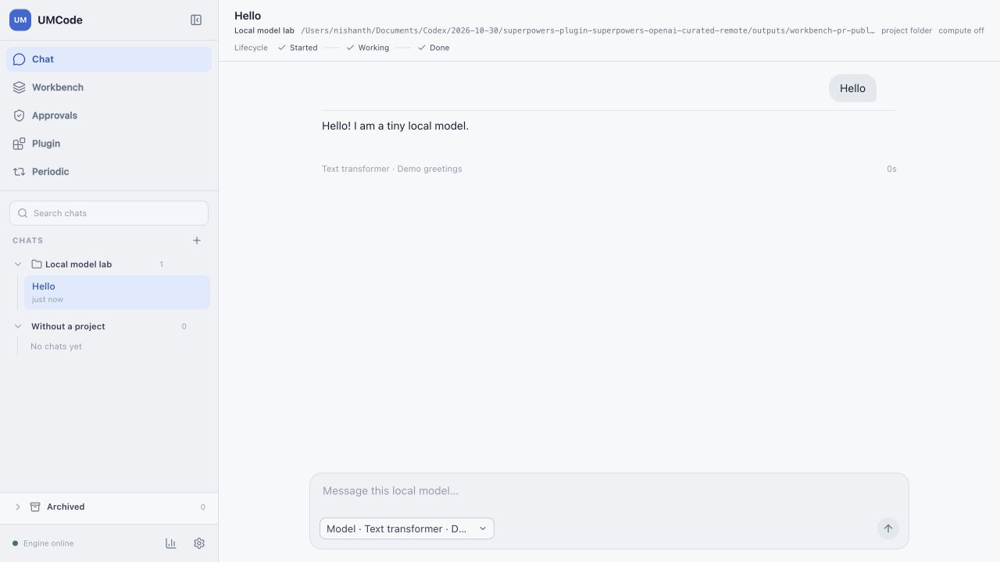

# Data and Inference workflows

Captured from the real Svelte app and Go engine using an isolated project and an
empty in-memory secret store. Numeric/text examples are synthetic trained fixtures;
Hugging Face inspection/download uses the real public native-file endpoint.

## Local data import and preparation

## Hugging Face inspection

## Test an architecture without trained weights

## Test a trained prompt and promote its checkpoint

## Use the promoted checkpoint in regular chat

The final capture needs no cloud API key, exposes plain text chat controls, and uses
real generated text from the pinned checkpoint. Train remains a placeholder.
