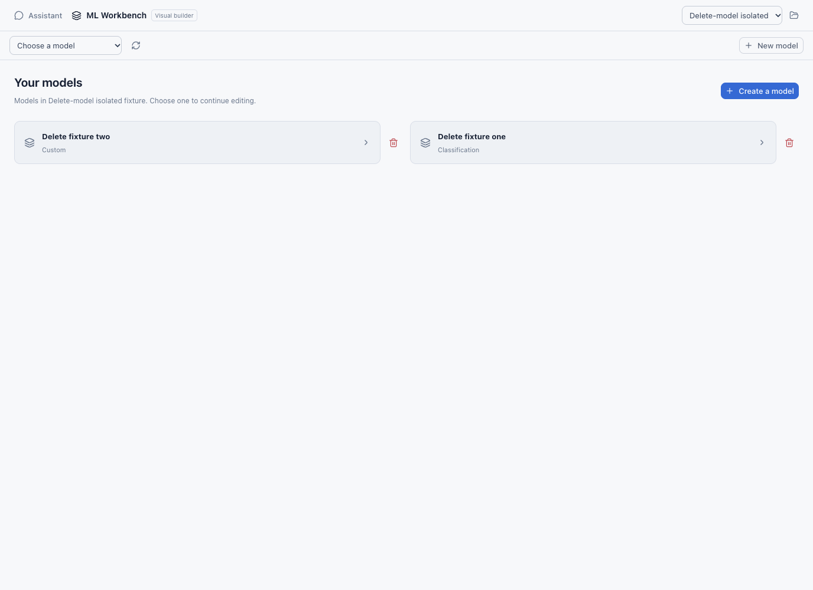
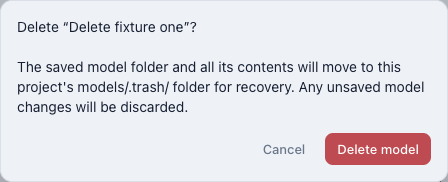
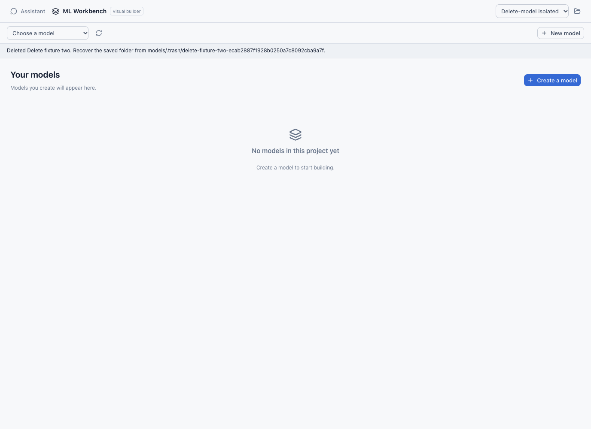

# Model deletion

Captured from the actual PR91 Svelte app and Go engine with an isolated test
home/project. These fixtures do not load or alter user projects. The Data-tab
implementation is separate local work and is not included in these captures.

## Delete from the model list

## Confirm or cancel with unsaved edits

Cancel preserves the model and its unsaved graph. Confirm moves the complete
saved model folder to project-local `models/.trash/`; unsaved edits are discarded.
Acceptance verifies the saved graph, dataset file and checkpoint remain intact.

## Deleting the final model

The list remains empty after reload. Creating a model requires an explicit
New model or Create a model action.
